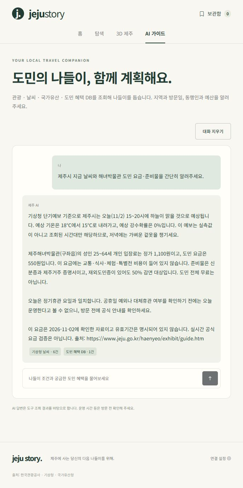

# 제주 스토리

**제주도민이 자신에게 적용되는 혜택을 확인하고, 조건에 맞는 제주 문화·여가 나들이를 계획하도록 돕는 여행 웹앱입니다.**

- [배포 홈페이지](https://jeju-local-trip.vercel.app/)
- [GitHub 저장소](https://github.com/silich0326-boop/prj)
- [3분 발표 대본과 시연 순서](docs/presentation.md)
- [배포 설정](docs/DEPLOYMENT.md)
- [AI 최종 검증 체크리스트](docs/AGENT-VALIDATION.md)

## 기획 의도

제주도민에게 제공되는 관람료 감면은 여러 시설의 홈페이지에 흩어져 있습니다. 할인율뿐 아니라 거주 증빙, 나이, 방문일, 휴관 여부까지 확인해야 실제 나들이에 활용할 수 있습니다.

제주 스토리는 제주 주민을 대상으로 문화시설과 지역 콘텐츠를 탐색하고, 공식 출처가 있는 혜택을 비교·저장하도록 만들었습니다. 해녀 문화, 제주의 생활사, 돌 문화와 미술관을 중심으로 제주 문화 IP와 주민의 문화생활을 연결합니다.

AI는 장소·날씨·국가유산·혜택 DB를 도구로 조회하도록 구현했습니다. **Claude Sonnet 5.5 연결 후 배포본에서 실제 질문 7건을 검증했습니다. 날씨·관광·국가유산·도민 혜택 도구 호출, 복합 질문의 연속 호출, 허위 장소·할인 생성 방지와 임시휴관 안내를 확인했습니다.**

## 구현 및 검증 상태

2026.11.02 점검 기준입니다. 데이터 건수는 점검 당시 응답이며 이후 달라질 수 있습니다.

| 항목 | 상태 | 확인 내용 |
|---|---|---|
| React·Router·Store | 구현 | 페이지·컴포넌트·라우터·공유 상태 분리 |
| 관광정보 API | 배포본 조회 확인 | 해녀 검색 3건 |
| 기상청 단기예보 API | 배포본 조회 확인 | 제주시 시간별 예보 6건 |
| 국가유산 API | 배포본 조회 확인 | 관덕정 검색 1건 |
| 도민 혜택 DB | 배포본 조회 확인 | 공식 안내로 조사한 5곳 |
| 즐겨찾기 | 저장·조회 확인 | 브라우저 저장과 Supabase 업로드·불러오기 |
| 모바일 | 점검 | 390px 홈·보관함·AI 화면의 가로 넘침 및 메뉴 이동 확인 |
| AI 에이전트 | 배포본 실측 확인 | Sonnet 5.5 질문 7건 HTTP 200, 복합 질문 도구 연속 호출. 아래 검증 범위·한계 참고 |
| Three.js | 기본 동작 확인 | 섬 회전·확대·예시 핀 선택. API 좌표 연동 미구현 |
| 배포 | 완료 | 고정 Production 주소와 GitHub 자동 배포 |

## 사용자 흐름

1. 홈 또는 탐색에서 혜택 DB 목록을 확인합니다. ‘Supabase 조회 완료’ 표시로 실제 DB 조회와 조사 자료 표시를 구분합니다.
2. 장소·지역·공간·성인 도민 입장료 조건으로 목록을 좁힙니다.
3. 카드에서 일반/도민 요금, 증빙, 확인일, 공식 출처와 휴관 안내를 확인합니다.
4. 북마크한 장소는 보관함에서 Supabase에 업로드하거나 다시 불러올 수 있습니다.
5. 홈의 나들이 조건을 AI 입력창으로 전달할 수 있습니다. 연결된 AI가 관련 도구를 조회하고 답변합니다. 키 누락 시에는 설정 안내가 표시됩니다.

## 공공 API 3개와 AI 도구

| 데이터 | 기관 | 사용 목적 | AI 도구 |
|---|---|---|---|
| [국문 관광정보](https://www.data.go.kr/data/15101578/openapi.do) | 한국관광공사 | 제주 장소 검색·위치·주소 | `search_tour_places` |
| [단기예보](https://www.data.go.kr/data/15084084/openapi.do) | 기상청 | 시간별 기온·하늘·강수확률 | `get_weather` |
| [국가유산 검색](https://www.khs.go.kr/cha/SearchKindOpenapiList.do?ccbaCtcd=50&pageUnit=10&pageIndex=1) | 국가유산청 | 제주 국가유산 조회 | `search_heritage` |
| 공식 안내 조사 자료 | 시설별 공식 홈페이지 → Supabase | 도민 요금·증빙·휴관 확인 | `search_resident_benefits` |

**공공 API는 3개이며, 도민 혜택 DB는 별도의 네 번째 도구입니다.** 직접 조사한 DB를 네 번째 공공 API로 계산하지 않습니다.

브라우저는 `/api/*` 서버 함수를 거쳐 공공 API와 AI를 호출합니다. 화면과 에이전트가 `server/`의 조회 함수를 공유합니다. 공공데이터 인증키와 AI 키는 브라우저 코드에 넣지 않습니다.

## 공식 출처가 있는 혜택 5곳

확인일은 2026.11.02이며 성인 25~64세 개인 입장료 기준입니다. 아동·동반인·단체·특별전의 가격으로 확대 적용하지 않습니다.

| 장소·공식 안내 | 일반 요금 | 도민 요금 | 참고 |
|---|---:|---:|---|
| [해녀박물관](https://www.jeju.go.kr/haenyeo/exhibit/guide.htm) | 1,100원 | 550원 | 신분증·거주 증빙 확인 |
| [민속자연사박물관](https://www.jeju.go.kr/museum/guidance/view.htm) | 2,000원 | 1,000원 | 구체적 증빙서류는 별도 확인 필요 |
| [김창열미술관](https://kimtschang-yeul.jeju.go.kr/cnt/cntManagerView.do?idx=12&menuNum=7200) | 2,000원 | 1,000원 | 대상별 증빙서류 지참 |
| [현대미술관 본관](https://www.jeju.go.kr/jejumuseum/guide/viewing.htm) | 2,000원 | 1,000원 | 공식 50% 감면율로 계산, 특별전 등 별도 조건 |
| [돌문화공원](https://www.jeju.go.kr/jejustonepark/intro/guide.htm) | 5,000원 | 2,500원 | 공식 50% 감면율로 계산, 중복 할인 불가 |

현대미술관 본관·박광진관의 [2026.11.03~11.05 임시휴관 공지](https://www.jeju.go.kr/jejumuseum/news/news.htm?act=view&seq=2037370)를 별도 기록했습니다. 매주 월요일 정기휴관과 공휴일 예외도 확인해야 합니다. 명시된 휴관이 없다고 영업을 보장하지 않습니다.

혜택 DB는 실시간 요금 수집 서비스가 아닙니다. 공식 출처·확인일·유효기간 미명시 여부를 함께 표시하며, 방문 전 최신 안내를 확인해야 합니다. 교통·식사·체험 비용은 입장료에 포함하지 않습니다.

## 실행

Node.js 22.x에서 프로젝트 폴더를 열고 실행합니다.

```powershell
npm ci
Copy-Item .env.example .env.local
npm run dev -- --port 5174
```

`.env.local`이 이미 있다면 복사 명령으로 덮어쓰지 말고 기존 파일을 수정하세요. `start.cmd`로도 실행할 수 있으며 사용 중인 포트에 따라 표시되는 Local 주소를 확인합니다. `index.html` 더블클릭으로는 실행되지 않습니다.

개발 서버는 로컬 API 미들웨어를 포함하므로 `npm run dev`로 화면과 API를 함께 실행합니다. `npm run preview`는 빌드된 정적 화면만 제공하며 API 검증용이 아닙니다.

| 환경변수 | 용도 |
|---|---|
| `VITE_SUPABASE_URL` | Supabase Project URL |
| `VITE_SUPABASE_ANON_KEY` | 공개용 Publishable 또는 기존 anon 키 |
| `DATA_GO_KR_KEY` | 관광정보·기상청 활용신청을 완료한 Decoding 인증키 |
| `ANTHROPIC_API_KEY` | 강사가 제공하는 앱 전용 AI 키 |
| `ANTHROPIC_MODEL` | 과제 안내서 지정 `claude-sonnet-5-5` |

Supabase 공개키 자리에 Secret/service_role 키를 넣지 않습니다. 공공데이터·AI 비밀키에 `VITE_`를 붙이지 않습니다. `.env.local`, `.vercel`, `node_modules`, `dist`는 Git에서 제외합니다. AI 키는 코딩 도구용이 아닌 앱 에이전트용입니다.

## Supabase 설정과 저장 방식

1. Supabase에서 Anonymous Sign-Ins를 활성화합니다.
2. SQL Editor에서 `supabase/schema.sql`을 실행합니다. 개인 즐겨찾기는 사용자별 RLS로 제한됩니다.
3. `supabase/resident-benefits.sql`을 실행하면 공용 혜택 테이블과 조사 자료 5곳이 생성됩니다. 기존 자료가 있는 경우 같은 ID의 혜택은 이 파일의 조사 자료로 갱신되므로 내용을 확인한 뒤 실행하세요.
4. 공용 혜택은 누구나 읽을 수 있고 브라우저 사용자는 수정할 수 없습니다.

즐겨찾기 북마크는 브라우저에 유지되며 ‘Supabase에 업로드’로 DB에 추가·갱신합니다. ‘DB에서 불러오기’는 현재 익명 사용자의 목록을 조회해 브라우저 목록과 합칩니다. 북마크 취소는 브라우저 목록에만 적용되므로 DB에서 불러오면 다시 나타날 수 있습니다.

다른 브라우저·기기·로컬과 배포 주소는 별도 익명 사용자입니다. 동일 닉네임 기반 기기간 공유·정식 계정 로그인·DB 삭제 동기화는 미구현입니다. AI 대화는 Store 메모리에서 메뉴 이동 시 유지되고 새로고침하면 초기화되며, DB에는 저장하지 않습니다.

## 코드 구조

```text
api/                 Vercel 서버 함수
server/              공공 API·혜택 조회, AI 도구 설명과 실행 루프
src/
  main.jsx           React 진입점
  App.jsx            BrowserRouter·오류 경계
  router.jsx         주소별 페이지
  layouts/           공용 메뉴·푸터
  pages/             홈·탐색·지도·AI·보관함·설정
  components/        카드·혜택 필터·날씨 표·3D 로딩
  store/             공유 즐겨찾기·AI 대화
  api/               브라우저의 서버 호출 모음
  lib/               Supabase·저장/혜택 공용 로직
  data/              예시 장소·공식 안내 조사 자료
supabase/            테이블·RLS·초기 자료 SQL
tests/               도구 조회와 모의 AI 루프 테스트
docs/                배포·발표·최종 검증 안내
```

## 검사와 AI 검증

```powershell
npm test
npm run lint
npm run build
```

자동 테스트 3개는 혜택 가격·날짜 검증, 가짜 모델 응답에 따른 혜택→날씨 연속 호출, DB 실패 처리·5회 반복 제한을 확인합니다. **실제 모델의 도구 선택 능력이나 추천 품질을 검증한 것은 아닙니다.**

배포본 Claude Sonnet 5.5 질문 7건을 실제 실행했습니다. [검증 결과와 한계](docs/AGENT-VALIDATION.md), [실제 응답 원본](docs/agent-validation-results.json)을 참고하세요. 예보를 관측처럼 표현한 첫 결과를 발견해 지침을 보완했고, 브라우저 재검사에서 단기예보임을 밝히는 답변을 확인했습니다. 답변 길이는 요청한 5문장을 넘을 수 있어 추가 개선 대상입니다.



## 남은 작업

- [x] AI 키를 로컬·Vercel에 등록하고 실제 도구 선택·2개 이상 연속 호출·허위 정보 방지 검증
- [x] 실제 AI 테스트 화면 캡처를 README에 추가
- [ ] 3분 발표 리허설 및 검증된 내용으로 대본 확정
- [ ] 안내서의 다른 브라우저 동일 사용자 조회까지 맞추려면 계정 로그인 보완
- [ ] 선택 사항: API·AI 추천 결과를 3D 지도 좌표와 연결

현재 3D 지도는 고정 예시 핀이 있는 일러스트입니다. 공용 혜택 목록은 실제 DB 조회 결과이며, 일반 탐색 예시 카드와 구분합니다. Three.js 사용과 API 핀 연동은 별도의 구현 상태입니다.
