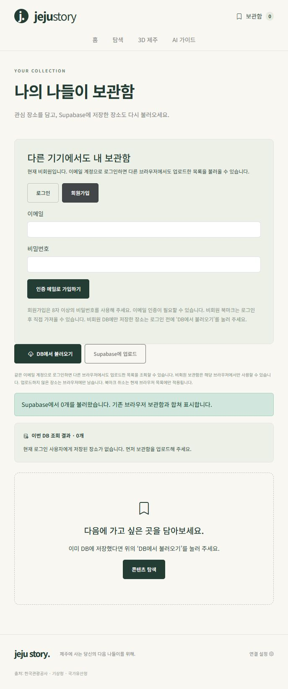

# 이메일 계정과 다른 브라우저의 보관함

## 구현 범위

- `/saved`에서 Supabase 이메일·비밀번호 회원가입 및 로그인.
- 회원가입 후 이메일 인증, 같은 계정으로 다른 브라우저에서 로그인.
- 기존 사용자 ID 기반 RLS 유지. 닉네임으로 다른 사람 목록을 조회하지 않습니다.
- 계정이 바뀌면 브라우저 보관함·조회 결과도 분리합니다.
- 기존 비회원 북마크는 브라우저에 보존하고 로그인 후 ‘비회원 북마크 가져오기’로 직접 합칩니다. DB 업로드는 별도 버튼입니다.
- 로그아웃은 현재 브라우저 세션에만 적용되며 DB 데이터는 삭제하지 않습니다.
- 비밀번호는 Supabase Auth로 전송하며 앱 Store·DB 테이블·로그에 저장하지 않습니다. Supabase 세션은 SDK에서 관리합니다.

## Supabase에서 한 번 설정

[Supabase Dashboard](https://supabase.com/dashboard)에서 이 앱의 프로젝트를 선택합니다.

1. Authentication → URL Configuration을 엽니다.
2. Site URL: `https://jeju-local-trip.vercel.app`
3. Redirect URLs에 `https://jeju-local-trip.vercel.app/saved`를 추가합니다.
4. 로컬 가입 테스트도 한다면 `http://127.0.0.1:5174/saved`도 추가합니다.
5. Email provider와 회원가입을 활성화합니다. 이메일 확인은 유지합니다.

2026.11.02 공개 Auth 설정 API에서 Email 활성화·회원가입 허용·이메일 확인 필요를 확인했습니다. 관리 권한이 필요한 Site URL·Redirect 허용 목록과 메일 발송 설정은 자동으로 변경하지 않았습니다.

Supabase 기본 메일 발송은 수신 대상·발송량 제한이 있을 수 있습니다. 실제 이메일이 거절되면 Authentication 메일 설정에서 프로젝트가 허용하는 주소 또는 SMTP 구성을 확인하세요. 이메일 인증을 끄는 것으로 우회하지 않습니다.

## 실제 검증 순서

1. 기존 비회원으로 DB에만 저장한 장소가 있다면 로그인 전에 ‘DB에서 불러오기’를 누릅니다.
2. 보관함의 회원가입에서 본인 이메일과 새 비밀번호를 직접 입력합니다. 비밀번호는 채팅에 공유하지 않습니다.
3. 수신한 인증 메일의 링크를 열어 이메일을 확인하고 로그인합니다.
4. 비회원 북마크를 계정으로 옮기려면 ‘비회원 북마크 가져오기’ → ‘Supabase에 업로드’를 누릅니다.
5. 별도 브라우저(예: Edge 또는 시크릿 창)에서 배포본에 접속합니다.
6. 같은 이메일 계정으로 로그인 → ‘DB에서 불러오기’. ‘이번 DB 조회 결과’에 동일 장소가 나오는지 확인합니다. 브라우저 로컬 목록만으로 성공을 판단하지 않습니다.
7. 새로고침 후에도 다시 DB 조회되는지 확인합니다.

가입 시 인증 메일을 보내며, 가입 완료는 이메일 확인 후에 확정됩니다. 이미 가입한 이메일에 대한 안내는 계정 존재 여부가 노출되지 않도록 일반적인 내용으로 표시될 수 있습니다.

## 현재 검증 상태

- [x] 이메일 provider·회원가입 활성화 확인
- [x] 비회원 목록 보존·계정 간 브라우저 목록 분리 자동 테스트
- [x] 정식 사용자 세션 유지·사용자 ID별 DB 조회 모의 테스트
- [x] 테스트·코드 검사·프로덕션 빌드
- [ ] 본인 이메일 가입·메일 수신·이메일 확인
- [ ] 실제 같은 계정으로 서로 다른 브라우저에서 DB 업로드·조회

실제 메일 수신과 두 브라우저 계정 로그인은 사용자 확인이 남아 있습니다. 모의 테스트를 이 단계의 실측 성공으로 표시하지 않습니다.

북마크 취소의 DB 삭제 동기화와 비밀번호 재설정 UI는 이번 변경 범위에 포함하지 않았습니다. 브라우저 캐시는 해당 기기의 localStorage에 남으므로 공용 기기에서 개인정보 저장용으로 사용하지 마세요.

참고: [Supabase 이메일·비밀번호 인증](https://supabase.com/docs/guides/auth/passwords), [회원가입 API](https://supabase.com/docs/reference/javascript/auth-signup).

## 배포 화면 확인

2026.11.02 배포본에서 로그인/회원가입 전환, 비밀번호 최소 8자 조건, 비회원 DB 조회 0건의 실제 응답을 확인했습니다. 계정 간 조회 성공 검증과는 별도입니다.

